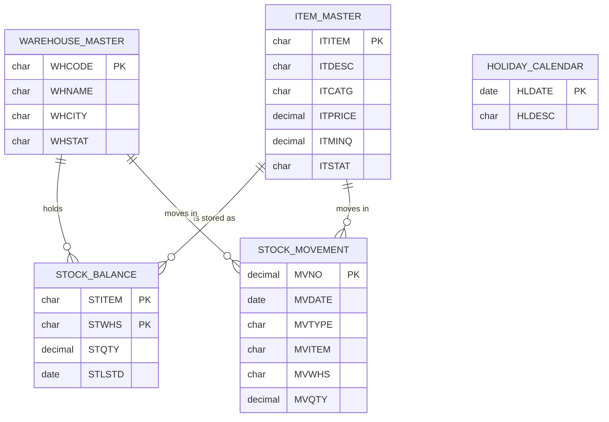
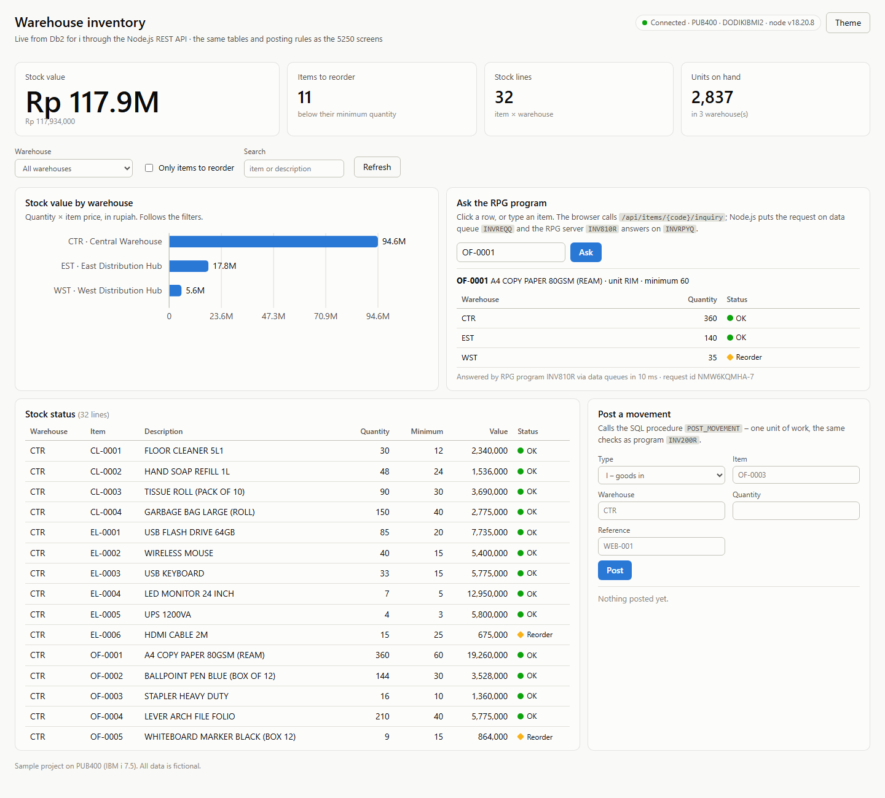

# IBM i Warehouse Inventory

[](https://github.com/dodikibmi/ibmi-inventory/actions/workflows/ci.yml)

A complete green-screen inventory application for IBM i, written in RPG IV (hybrid
free-format), Db2 for i SQL, DDS and CL. It covers the programs a typical IBM i shop
maintains every day — master-file maintenance, subfiles, a transaction with commitment
control, a printed report, a JSON export and a unit-tested service program — on a
fictional warehouse domain.

Built and tested on [PUB400.COM](https://pub400.com) (IBM i 7.5). All data is fictional.

## Features

| # | Program | Type | What it shows |
|---|---|---|---|
| 1 | `INVMENU` | CLLE + DSPF | Main menu, library list handling, error trapping with `MONMSG` |
| 2 | `INV100R` | RPGLE + DSPF | Load-all subfile, position-to, options 2/4/5/6, total stock per item |
| 3 | `INV110R` | RPGLE + DSPF | Add / change / delete / display in one screen, field-level errors, **optimistic locking**, audit columns |
| 4 | `INV200R` | RPGLE + DSPF | Goods in / out / adjustment with **commitment control**: stock update and movement insert commit or roll back together; re-check under record lock; date field of type `L` |
| 5 | `INV300R` | RPGLE + DSPF | Stock card: opening balance derived backwards, running balance, drill-down from the item list |
| 6 | `INV400R` | SQLRPGLE + PRTF | 132-column report, **multi-row FETCH** into a DS array, level break per warehouse, page overflow |
| 7 | `INV500R` | SQLRPGLE | JSON document built by Db2 in one statement (`JSON_OBJECT`, `JSON_ARRAYAGG`) and written with `QSYS2.IFS_WRITE_UTF8` |
| 8 | `INV900R` | RPGLE + DSPF | Reusable **F4 prompt window** (subfile in a `WINDOW`), field detected with `RTNCSRLOC` |
| 9 | `DATEUTIL` | ILE service program | NOMAIN module, binder source with `*CURRENT` / `*PRV` signatures, holiday table lookup |
| 10 | `DATEUTILT` | RPGUnit test suite | 8 test cases, 24 assertions |
| 11 | `INV600R` | SQLRPGLE | **REST client**: `QSYS2.HTTP_GET_VERBOSE` (HTTP status checked) + `JSON_TABLE` + `MERGE` loads public holidays from a web API |
| 12 | `POST_MOVEMENT` | SQL PL procedure | Posting rules in the database: validation, row lock, `SIGNAL SQLSTATE`, `SELECT ... FROM FINAL TABLE (INSERT ...)` |
| 13 | `api/server.py` | Python 3.9 in PASE | **REST API** over the same tables: GET items / stock / movements, POST movements with commit / rollback and proper HTTP status codes |
| 14 | `INV700R` | SQLRPGLE | **Outbound webhook**: reorder alert built with `LISTAGG` (one line per warehouse) + `JSON_OBJECT`, sent with `QSYS2.HTTP_POST_VERBOSE`; non-2xx status ends with an escape message |
| 15 | `INV810R` | SQLRPGLE | **Data queue server**: stock inquiry requests on `INVREQQ` (`QRCVDTAQ`), replies on keyed `INVRPYQ` (`QSNDDTAQ`, key = request id); UTF-8 JSON parsed with `JSON_TABLE`, answered with `JSON_OBJECT` |
| 16 | `INV820C` | CLLE | **CSV file interface**: stock export with `CPYTOIMPF` (UTF-8, header row), price list import with `CPYFRMIMPF` into a staging table, every row checked by `APPLY_PRICE_UPDATE` |
| 17 | `INV830R` | SQLRPGLE | **XML file interface**: supplier delivery note read with `XML-INTO`, posted through `POST_MOVEMENT` as one unit of work; duplicate notes rejected; also callable as SQL procedure `POST_DELIVERY_NOTE` |
| 18 | `integration/node-api` | Node.js in PASE | **REST API provider** with `idb-connector`: stock, POST movements (commit / rollback), and an inquiry endpoint answered by the RPG data queue server |
| 19 | `integration/web` | HTML + JavaScript | **Web dashboard** ("green screen to web"): stock value, reorder count, value per warehouse, stock table, inquiry answered by RPG, movement posting - served by the Node.js API, no framework, light and dark theme |
| 20 | `INV850C` | ILE COBOL + SQL | **COBOL calling RPG**: reorder plan from an SQL cursor; order and delivery dates from the RPG service program `DATEUTIL` (`CALL PROCEDURE`), one unit of work; callable as `BUILD_REORDER_PLAN` |

## Screenshots

All screens were captured on PUB400 with the sample data.

### Main menu and item list

| Main menu (`INVMENU`) | Work with items: load-all subfile (`INV100R`) |
|---|---|
|  |  |

### Item maintenance (`INV110R`)

| Change an item, with audit columns | Field-level validation on add |
|---|---|
|  |  |

### Stock card and stock movements

| Stock card with running balance (`INV300R`) | F4 prompt window over the entry screen (`INV900R`) |
|---|---|
|  |  |

| Movement entry rejects an unknown item (`INV200R`) | Stock status report in the spool (`INV400P`) |
|---|---|
|  |  |

### Service program and unit tests

| RPGUnit suite `DATEUTILT` passes | `DATEUTIL` keeps two signatures (`*CURRENT` and `*PRV`) |
|---|---|
|  |  |

### REST API

| `GET /api/items/OF-0001` | `GET /api/stock?warehouse=EST&reorder=Y` |
|---|---|
|  |  |

`POST /api/movements` with more than the stock on hand returns `409`:


## Database

Tables are created with SQL DDL (primary keys, foreign keys, check constraints, identity
column, labels). Each table has a 10-character system name and a record format, so RPG
uses native I/O (`CHAIN`, `SETLL`/`READE`, `WRITE`, `UPDATE`) on the SQL indexes.



| SQL name | System name | Keyed access (index) |
|---|---|---|
| `WAREHOUSE_MASTER` | `INVWHS` | `INVWHS1` by code |
| `ITEM_MASTER` | `INVITM` | `INVITM1` by code, `INVITM2` by description |
| `STOCK_BALANCE` | `INVSTK` | `INVSTK1` by item + warehouse |
| `STOCK_MOVEMENT` | `INVMOV` | `INVMOV1` by item + warehouse + date + number |
| `HOLIDAY_CALENDAR` | `INVHOL` | `INVHOL1` by date |
| `STOCK_STATUS` (view) | `INVSTKV` | used by the report and the JSON export |

Three layers protect the stock from going negative: validation in `INV200R`, a second
check while the stock row is locked, and `CHECK (STQTY >= 0)` in the database.

## Design notes

- **Hybrid free-format RPG.** H, F, D and P specs are fixed-format; logic is in `/free`
  blocks. This is the style most existing IBM i shops maintain, and it compiles on any
  release that has free-format calculations.
- **Optimistic locking** (`INV110R`). The record is shown without a lock and re-read with
  a lock before the update; if the change timestamp differs, another user changed it and
  the screen is reloaded instead of overwriting their work. No lock is held while the
  user is typing.
- **Commitment control started by the program** (`INV200R`). `STRCMTCTL
  LCKLVL(*CHG) CMTSCOPE(*ACTGRP)` through `QCMDEXC`, then the journaled files are opened
  (`COMMIT USROPN`). The tables are journaled automatically because the data library
  contains journal `QSQJRN`.
- **Identity column and native I/O.** `MVNO` is generated by Db2 on the RPG `WRITE`; the
  program reads it back before `COMMIT`, while it still holds the stock row lock.
- **Service program versioning** (`DATEUTILB`). Version 1.00 had seven exports; 2.00 added
  `DateAddWdays` at the end. The `*PRV` block keeps the 1.00 signature valid, so programs
  bound to 1.00 run without being re-bound. Both signatures and the one each caller is
  bound to can be checked with SQL (`QSYS2.PROGRAM_INFO.EXPORT_SIGNATURES`,
  `QSYS2.BOUND_SRVPGM_INFO.BOUND_SERVICE_PROGRAM_SIGNATURE`; the signature is the
  EBCDIC text, e.g. `C4C1E3C5E4E3C9D340E5F24BF0F04040` = `DATEUTIL V2.00`).
- **One reusable prompt window** (`INV900R`) serves items, warehouses and movement types.
  A `DUMMY` record with `ASSUME` keeps the calling screen visible under the window.

## REST API

The same data is available as JSON over HTTP, served by a small Python program that
runs in PASE on the IBM i itself (`api/server.py`, standard library + `ibm_db`, which
both ship with the IBM i open-source packages). Writes go through the SQL procedure
`POST_MOVEMENT`, so the API and the green screens apply exactly the same rules.

| Method | Path | Result |
|---|---|---|
| GET | `/api/health` | database and schema in use |
| GET | `/api/items?category=OFFC&status=A` | item list |
| GET | `/api/items/{code}` | one item with stock per warehouse |
| GET | `/api/stock?warehouse=CTR&reorder=Y` | stock status, optionally only items to reorder |
| GET | `/api/movements?item=OF-0001&warehouse=CTR&from=2026-09-01` | movement history |
| POST | `/api/movements` | post a movement; `201` with the movement number and new stock |

Errors are JSON with a matching status: `400` invalid input, `404` unknown item or
inactive warehouse, `409` insufficient stock, `500` anything unexpected.

```text
POST /api/movements  {"type":"O","item":"OF-0001","warehouse":"CTR","quantity":5,"reference":"DO-1"}
201  {"number": 18, "item": "OF-0001", "warehouse": "CTR", "type": "O", "quantity": 5,
      "date": "2026-09-26", "on_hand": 320}

POST /api/movements  {"type":"O","item":"EL-0005","warehouse":"CTR","quantity":999}
409  {"error": "Insufficient stock for this movement"}
```

Run it on PUB400 (one command from a PC; it opens an SSH tunnel to port 48400, asks
the database password without echo and starts the server):

```text
ssh -t -p 2222 -L 48400:127.0.0.1:48400 USER@pub400.com /QOpenSys/pkgs/bin/bash /home/USER/inventory/api/start_api.sh
```

Then open `http://localhost:48400/api/health` in the browser. `api/test_api.sh` runs a
smoke test with `curl` (success and error cases).

The other direction — RPG calling a web service — is `INV600R`: Db2 fetches
`https://date.nager.at/api/v3/PublicHolidays/{year}/ID` with `QSYS2.HTTP_GET_VERBOSE`
(plain `HTTP_GET` hands back the body of a 404 without any SQL error, so the program reads
the status code first and stops with `CPF9898` on anything outside 200-299),
`JSON_TABLE` turns the array into rows and `MERGE` inserts or updates
`HOLIDAY_CALENDAR` for this year and next year. `DATEUTIL` picks the new dates up
immediately, without a recompile. (That free API lists the fixed national holidays;
holidays that follow the lunar calendar are not included.)

`INV700R` pushes data out: `LISTAGG` collapses the items below their minimum into one
line per warehouse (`WST (CL-0001, OF-0001, PK-0001, PK-0003)`), Db2 wraps it in a JSON
message and `QSYS2.HTTP_POST_VERBOSE` posts it to a webhook (default `https://httpbin.org/post`,
pass a Slack/Teams/ERP URL as the first parameter). The HTTP status is read from the response
header JSON; anything outside 200-299 ends the program with `CPF9898`, so a CL job can
`MONMSG` it.

```text
CALL INV700R                     /* posts to the default https://httpbin.org/post */
```

From CL, pass your own URL in a `*CHAR 200` variable (a literal on a command-line `CALL`
is only as long as its text, and the program reads 200 bytes).

## Integration

How the IBM i application talks to other systems (`integration/`, `sql/04_integration.sql`).
Everything was run on PUB400; the full output is in
[`docs/integration-demo.txt`](docs/integration-demo.txt) (`integration/run_demo.sh`).

| Pattern | Objects | Result on PUB400 |
|---|---|---|
| **Data queue, request / reply** | RPG server `INV810R`; clients `integration/dtaq_client.py` (Python) and the Node.js API | the same RPG program answers both; unknown item → `{"error":"item not found"}` |
| **CSV export** | `INV820C EXPORT` → `CPYTOIMPF` from the `STOCK_STATUS` view | 33 lines, UTF-8, header row with the SQL column names |
| **CSV import** | `INV820C IMPORT` → `CPYFRMIMPF` → `PRICE_UPDATE` → `APPLY_PRICE_UPDATE` | 3 rows applied, 2 rejected (`unknown item`, `price missing or negative`), the reason kept per row in `PRICE_UPDATE_RESULT` |
| **XML import** | `INV830R` (`XML-INTO`) / `CALL POST_DELIVERY_NOTE(path, ?)` | good note: 3 lines posted; same note again: rejected; note with an unknown item: line 2 fails and the whole note is rolled back |
| **REST provider (Node.js)** | `integration/node-api/server.js` | `GET /api/stock` 200, `POST /api/movements` 201, too much quantity 409 (`SQLSTATE 75006`), `GET /api/items/OF-0003/inquiry` 200 via the data queue |

Data queue messages are UTF-8 JSON: the RPG fields are declared `CCSID(*UTF8)`, and the
clients use `QSYS2.SEND_DATA_QUEUE_UTF8` / `RECEIVE_DATA_QUEUE` (`MESSAGE_DATA_UTF8`,
`KEY_DATA` = request id, `KEY_ORDER => 'EQ'`), so no side converts the text twice.
The reply queue is keyed so several clients can wait on it at the same time and each gets
its own answer.

```text
Python  ──┐  {"id":"P64696-1","item":"OF-0001"}            ┌─> INVRPYQ (key P64696-1)
          ├──────────────> INVREQQ ──> INV810R (RPG) ──────┤
Node.js ──┘                            JSON_TABLE / SQL     └─> INVRPYQ (key NMW6K2D8Q-2)
```

```sh
# once: data queues, staging tables, procedures
RUNSQLSTM SRCSTMF('sql/04_integration.sql') COMMIT(*NONE) NAMING(*SQL) DECMPT(*PERIOD)
cd integration/node-api && npm install          # idb-connector
bash integration/run_demo.sh                    # CSV, XML, data queues, Node.js API
```

On a production system `INV810R` runs as a batch job (`SBMJOB` or an autostart job entry)
and the Node.js API under a service manager; the demo starts both in the background of
one PASE session and stops them at the end (`{"cmd":"stop"}`).

## Web dashboard

The same stock, in a browser (`integration/web`: one HTML page, one script, one style
sheet, no framework and no build step). The Node.js API serves the page and its data, so
the browser talks to one origin; every number comes from Db2 for i at that moment.



- **Tiles**: stock value (quantity x price), items below their minimum, stock lines, units.
- **Stock value by warehouse**: bar chart drawn as SVG, follows the filters, tooltip per bar.
- **Ask the RPG program**: clicking a row calls `/api/items/{code}/inquiry`; Node.js puts the
  request on data queue `INVREQQ` and the RPG server `INV810R` answers on `INVRPYQ` (about
  10 ms on PUB400).
- **Post a movement**: calls `POST_MOVEMENT`, the same rules as the 5250 program `INV200R`;
  a rejected movement shows the reason (`409`, SQLSTATE `75006`) and changes nothing.
- The page only shows text through an escaping function, and the server maps the four
  allowed paths to files itself, so no URL reaches the file system.

[Dark theme](docs/screenshots/web-dashboard-dark.png) (follows the system setting, or the
*Theme* button).

```sh
# on the IBM i (INV810R running for the inquiry panel)
cd integration/node-api && INV_SCHEMA=DODIKIBMI2 PORT=48401 node server.js
# on the PC: ssh -p 2222 -L 48401:127.0.0.1:48401 USER@pub400.com, then open
# http://localhost:48401/
```

## ILE COBOL and RPG in one program

`qcblsrc/inv850c.sqlcblle` is an ILE COBOL program with embedded SQL that builds the
reorder plan, and its dates come from the same RPG service program the RPG programs use.
Bob compiles the COBOL source into a module (`CRTSQLCBLI ... OBJTYPE(*MODULE)`) and binds it
with `DATEUTIL` (`CRTPGM MODULE(INV850C) BNDSRVPGM(DATEUTIL)`), so the call is a bound ILE
call, not a dynamic program call.

```cobol
           CALL PROCEDURE "DATEADDWDAYS"
                USING BY REFERENCE WS-ORDER-DATE
                      BY REFERENCE WS-LEAD-DAYS
                RETURNING WS-EXPECTED.
```

| RPG prototype | COBOL side |
|---|---|
| `D CONST` (date, `DATFMT(*ISO)`) | `PIC X(10)` holding `YYYY-MM-DD`, `BY REFERENCE` |
| `10I 0 CONST` | `PIC S9(9) COMP-5`, `BY REFERENCE` (CONST is still passed by reference) |
| return `N` | `PIC X(1)` with `88 IS-WORKDAY VALUE "1"` |
| return `9A VARYING` | group of `PIC 9(4) COMP-5` length + `PIC X(9)` text |

Run on Saturday 2026-11-07, the program moved the order date to Monday 2026-11-09 and
planned 11 lines (457 units) with delivery dates 3, 5 and 7 working days later:
[`docs/cobol-reorder-plan.txt`](docs/cobol-reorder-plan.txt).

```text
RUNSQLSTM SRCSTMF('sql/05_reorder_plan.sql') COMMIT(*NONE) NAMING(*SQL) DECMPT(*PERIOD)
CALL BUILD_REORDER_PLAN(?)        -- from any SQL client
```

The COBOL SQL precompiler reads `'Y'` as a name, not a string, unless the module is
compiled with `OPTION(*APOSTSQL)` (the default is `*QUOTESQL`): the first run failed with
SQL0206 *Column Y not found*. The option is set for that one module in `qcblsrc/Rules.mk`.

## Build

Libraries: programs in `DODIKIBMI1`, data in `DODIKIBMI2`. Change the names to your own.
[iRPGUnit](https://github.com/tools-400/irpgunit) is needed only for the test suite.

The database is created once (it holds data, so the pipeline does not recreate it):

```text
/* Journal first: tables created in a library with QSQJRN are journaled */
CRTJRNRCV JRNRCV(DODIKIBMI2/INVRCV0001)
CRTJRN    JRN(DODIKIBMI2/QSQJRN) JRNRCV(DODIKIBMI2/INVRCV0001) MNGRCV(*SYSTEM) DLTRCV(*YES)

/* Tables, sample data, SQL procedure (stream files in the IFS) */
RUNSQLSTM SRCSTMF('sql/01_tables.sql') COMMIT(*NONE) NAMING(*SQL) DECMPT(*PERIOD)
RUNSQLSTM SRCSTMF('sql/02_data.sql')   COMMIT(*NONE) NAMING(*SQL) DECMPT(*PERIOD)
RUNSQLSTM SRCSTMF('sql/03_api.sql')    COMMIT(*NONE) NAMING(*SQL) DECMPT(*PERIOD)
RUNSQLSTM SRCSTMF('sql/04_integration.sql') COMMIT(*NONE) NAMING(*SQL) DECMPT(*PERIOD)
RUNSQLSTM SRCSTMF('sql/05_reorder_plan.sql') COMMIT(*NONE) NAMING(*SQL) DECMPT(*PERIOD)
```

The programs are built from the stream files with **IBM Bob** (`makei`, the open-source
build tool for IBM i, in `/QOpenSys/pkgs/bin`). `iproj.json` sets the object library and
library list; each source directory has a `Rules.mk` with one line per object and its
dependencies, so Bob builds them in the right order (display files, then the
`DATEUTIL` module and service program, the `INVENTORY` binding directory, then the
programs). Copybooks are stream files too (`/COPY dateutilpr.rpgleinc`): what is built
is exactly what is in Git.

```sh
# in PASE, from a clone of this repository on the IBM i
OBJLIB=DODIKIBMI1 DTALIB=DODIKIBMI2 ci/build.sh    # makei build + failure check, 24 objects
OBJLIB=DODIKIBMI1 RULIB=DODIKIBMI2  ci/test.sh     # RUCRTRPG from the stream file + RUCALLTST
```

```text
Objects:             0 failed 24 succeed 24 total
Build Successful!
...
Success. 8 test cases, 24 assertions, 0 failure, 0 error.
```

Then `CALL INVMENU`.

## Continuous integration

[`.github/workflows/ci.yml`](.github/workflows/ci.yml) (GitHub Actions):

| Job | Runs | What it does |
|---|---|---|
| `lint` | every push and pull request, on the GitHub runner | [`ci/lint.py`](ci/lint.py): no library-qualified `/COPY`, no tabs, fixed-format lines within 80 columns, every program an ILE program (`DFTACTGRP(*NO)`), `Rules.mk` and the source tree agree. `shellcheck` on the shell scripts. |
| `build-and-test` | on demand (*Run workflow*), on a **self-hosted runner** that can reach the IBM i | Over SSH to the IBM i: copies the commit to the IFS (`git archive` piped to `tar`, files tagged CCSID 1208), runs `ci/build.sh` and `ci/test.sh` (through `ci/ibmi-job.sh`, in one SSH session), fetches the compile listings as a build artifact and turns the compiler's EVFEVENT records into **annotations on the failing source lines** ([`ci/annotate.py`](ci/annotate.py)). |

Points that matter on IBM i:

- `makei` can print *Build Successful* with exit code 0 when make stopped before a
  target (a target that was never attempted is not counted as failed), so
  `ci/build.sh` also checks make's own error lines.
- The SSH key is a dedicated key for this pipeline only, stored as the secret
  `IBMI_SSH_KEY`; the host key of the IBM i is pinned in the workflow.
- The target is the shared public system PUB400, so the IBM i job runs on demand and
  one at a time (`concurrency`), not on every push.
- PUB400 refuses more than about two SSH logins in a short time, so copy, build and
  tests share one SSH session; `ci/ibmi-job.sh` prints `::group::` workflow commands,
  so build and tests still show as separate sections of the job log.
- PUB400 closes SSH connections from GitHub-hosted (cloud) runners before login, just
  as a company IBM i is reachable only from inside its network. The IBM i job therefore
  runs on a self-hosted runner (label `ibmi`) on a machine that can reach the system;
  lint still runs on GitHub's runners. Only a manual *Run workflow* (write access)
  sends work to the self-hosted runner, never a pull request from a fork. The SSH key
  is written to the job's temporary directory and removed at the end of the job.
- Checked both ways: a compile error (`RNF7030`) makes the build job fail, and a wrong
  expected value in `DATEUTILT` makes the test job fail
  (`FAILURE. 8 test cases, 23 assertions, 1 failure`).

## Sample output

Stock status report (`INV400P`, excerpt):

```text
Item        Description                               Cat   UOM       On hand     Minimum       Unit price           Stock value  R
------------------------------------------------------------------------------------------------------------------------------------
Warehouse EST  East Distribution Hub
CL-0003     TISSUE ROLL (PACK OF 10)                  CLNG  PAK           25          30        41.000,00          1.025.000,00   *
EL-0001     USB FLASH DRIVE 64GB                      ELEC  PCS           12          20        89.000,00          1.068.000,00   *
OF-0001     A4 COPY PAPER 80GSM (REAM)                OFFC  RIM          140          50        52.000,00          7.280.000,00
            Total     7 items,     5 to reorder                          487                                      17.521.000,00
GRAND TOTAL          32 items,    11 to reorder                        2.765                                     113.478.500,00
```

(Decimal comma because the PUB400 job runs with a German locale.)

JSON export: see [`docs/sample-stock_status.json`](docs/sample-stock_status.json).

Unit tests:

```text
RUCALLTST TSTPGM(DATEUTILT)
Success. 8 test cases, 24 assertions, 0 failure, 0 error.
```

## Notes from running on PUB400

- `FOR SYSTEM NAME` is rejected (SQL7029) when the SQL name is itself a valid system
  name, which is why the tables have names longer than 10 characters.
- `DEFAULT USER` needs a column of at least 18 characters (SQL0574).
- The job locale uses a decimal comma, so `RUNSQLSTM` runs with `DECMPT(*PERIOD)`.
- Batch jobs submitted from a user job queue do not match the batch subsystem's routing
  entries (CPC1117), so the menu prints the report in the interactive job. On a regular
  system that option would be `SBMJOB ... CALL PGM(INV400R)`.
- A local `ibm_db` connection with empty strings for user and password is refused
  (SQL30082), so the API connects with the user's credentials from environment
  variables. `ibm_db.connect("*LOCAL", None, None)` — `None`, not `""` — connects as the
  user of the job without a password; the integration scripts use that.
- `idb-connector` 1.3: `commit()` and `rollback()` of a statement run synchronously and
  never call the callback they are given; waiting for that callback hangs the request.
- `CLRDTAQ` is not available to users on PUB400; `QSYS2.CLEAR_DATA_QUEUE` does the same.
- A quoted string longer than 32 characters on a command-line `CALL` is passed with its
  own length, so `run_demo.sh` pads the IFS path to the 200 bytes `INV820C` declares.
- `ibm_db.callproc` sizes an OUT parameter buffer from its initial value and does not
  clear the rest after the returned digits, so the OUT parameters start as blanks.

## Repository layout

```text
sql/         01_tables.sql, 02_data.sql, 03_api.sql (procedure POST_MOVEMENT),
             04_integration.sql (data queues, CSV staging, POST_DELIVERY_NOTE),
             05_reorder_plan.sql (table + procedure for the COBOL program)
api/         server.py (REST API), start_api.sh, test_api.sh
integration/ node-api/ (Node.js REST API), web/ (dashboard), dtaq_client.py, run_demo.sh, samples/
qddssrc/     display files (*.dspf) and printer file (*.prtf)
qrpglesrc/   RPGLE / SQLRPGLE programs, DATEUTIL module, copybook, binder source, tests
qcblsrc/     ILE COBOL reorder plan (SQL + RPG service program)
qclsrc/      main menu, CSV interface (CLLE)
docs/        sample output, screenshots/
```

## License

© 2026 Dodik Setyawan. All rights reserved. The code is published for viewing as a
portfolio; reuse requires written permission. See [LICENSE](LICENSE).
