# IBM i Warehouse Inventory

A complete green-screen inventory application for IBM i, written in RPG IV (hybrid
free-format), Db2 for i SQL, DDS and CL. It covers the programs a typical IBM i shop
maintains every day — master-file maintenance, subfiles, a transaction with commitment
control, a printed report, a JSON export and a unit-tested service program — on a
fictional warehouse domain.

Built and tested on [PUB400.COM](https://pub400.com) (IBM i 7.5). All data is fictional.

## Features

| # | Program | Type | What it shows |
|---|---|---|---|
| 1 | `INVMENU` | CLLE + DSPF | Main menu, library list handling, error trapping with `MONMSG` |
| 2 | `INV100R` | RPGLE + DSPF | Load-all subfile, position-to, options 2/4/5/6, total stock per item |
| 3 | `INV110R` | RPGLE + DSPF | Add / change / delete / display in one screen, field-level errors, **optimistic locking**, audit columns |
| 4 | `INV200R` | RPGLE + DSPF | Goods in / out / adjustment with **commitment control**: stock update and movement insert commit or roll back together; re-check under record lock; date field of type `L` |
| 5 | `INV300R` | RPGLE + DSPF | Stock card: opening balance derived backwards, running balance, drill-down from the item list |
| 6 | `INV400R` | SQLRPGLE + PRTF | 132-column report, **multi-row FETCH** into a DS array, level break per warehouse, page overflow |
| 7 | `INV500R` | SQLRPGLE | JSON document built by Db2 in one statement (`JSON_OBJECT`, `JSON_ARRAYAGG`) and written with `QSYS2.IFS_WRITE_UTF8` |
| 8 | `INV900R` | RPGLE + DSPF | Reusable **F4 prompt window** (subfile in a `WINDOW`), field detected with `RTNCSRLOC` |
| 9 | `DATEUTIL` | ILE service program | NOMAIN module, binder source with `*CURRENT` / `*PRV` signatures, holiday table lookup |
| 10 | `DATEUTILT` | RPGUnit test suite | 8 test cases, 24 assertions |
| 11 | `INV600R` | SQLRPGLE | **REST client**: `QSYS2.HTTP_GET_VERBOSE` (HTTP status checked) + `JSON_TABLE` + `MERGE` loads public holidays from a web API |
| 12 | `POST_MOVEMENT` | SQL PL procedure | Posting rules in the database: validation, row lock, `SIGNAL SQLSTATE`, `SELECT ... FROM FINAL TABLE (INSERT ...)` |
| 13 | `api/server.py` | Python 3.9 in PASE | **REST API** over the same tables: GET items / stock / movements, POST movements with commit / rollback and proper HTTP status codes |
| 14 | `INV700R` | SQLRPGLE | **Outbound webhook**: reorder alert built with `LISTAGG` (one line per warehouse) + `JSON_OBJECT`, sent with `QSYS2.HTTP_POST_VERBOSE`; non-2xx status ends with an escape message |

## Screenshots

All screens were captured on PUB400 with the sample data.

### Main menu and item list

| Main menu (`INVMENU`) | Work with items: load-all subfile (`INV100R`) |
|---|---|
| 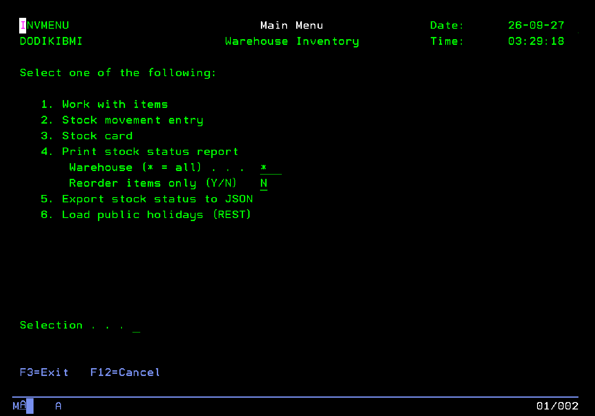 | 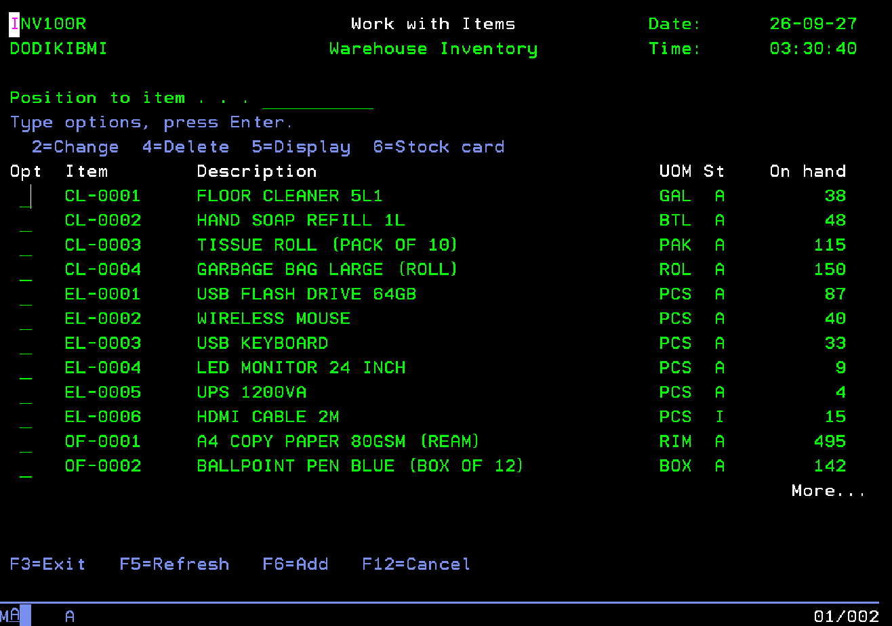 |

### Item maintenance (`INV110R`)

| Change an item, with audit columns | Field-level validation on add |
|---|---|
| 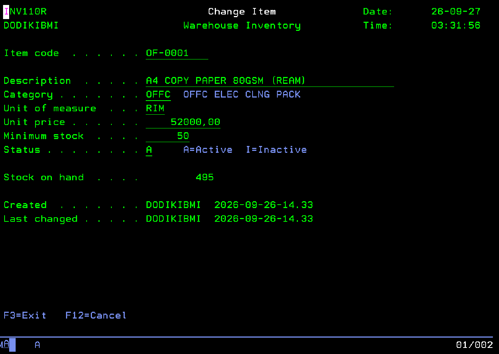 | 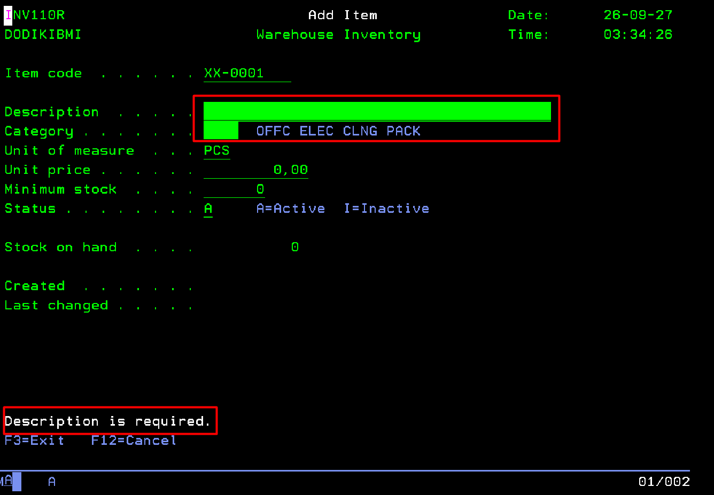 |

### Stock card and stock movements

| Stock card with running balance (`INV300R`) | F4 prompt window over the entry screen (`INV900R`) |
|---|---|
| 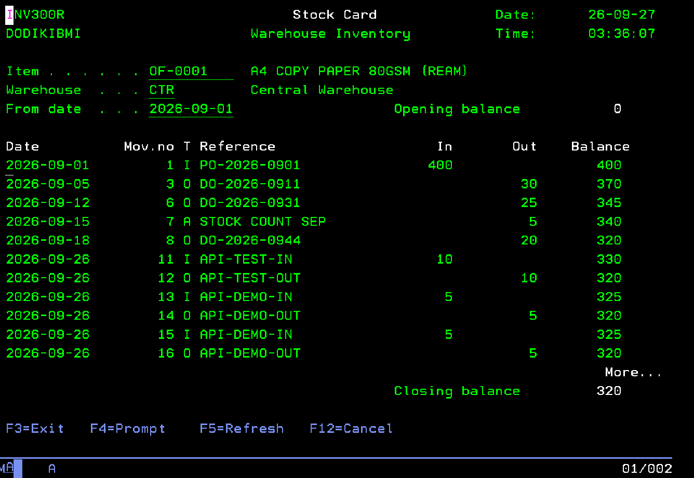 | 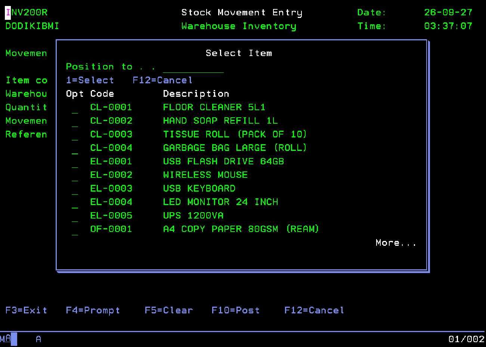 |

| Movement entry rejects an unknown item (`INV200R`) | Stock status report in the spool (`INV400P`) |
|---|---|
| 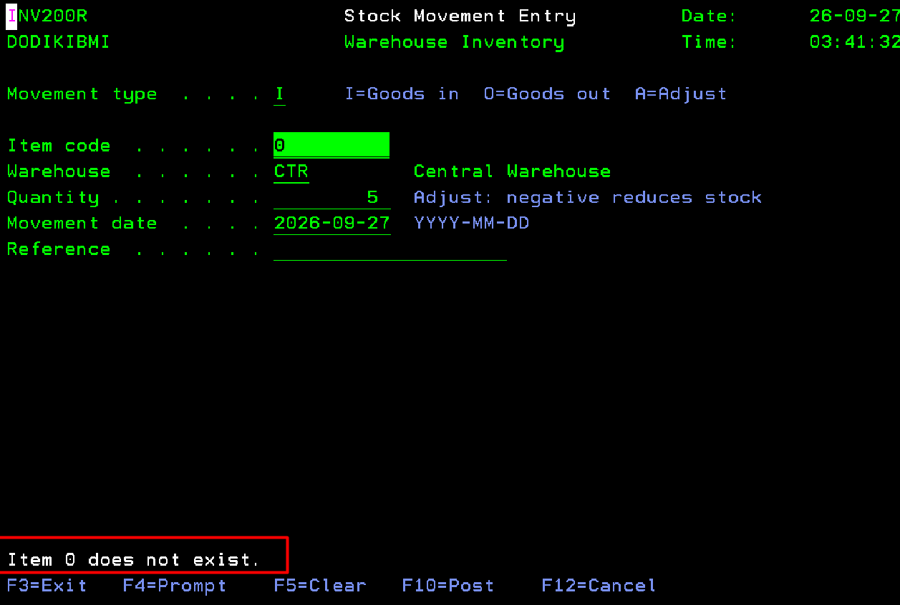 | 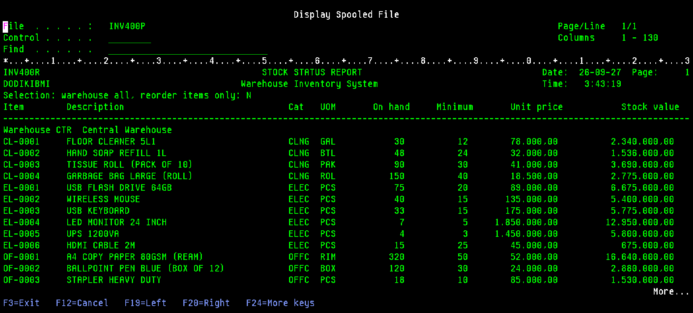 |

### Service program and unit tests

| RPGUnit suite `DATEUTILT` passes | `DATEUTIL` keeps two signatures (`*CURRENT` and `*PRV`) |
|---|---|
| 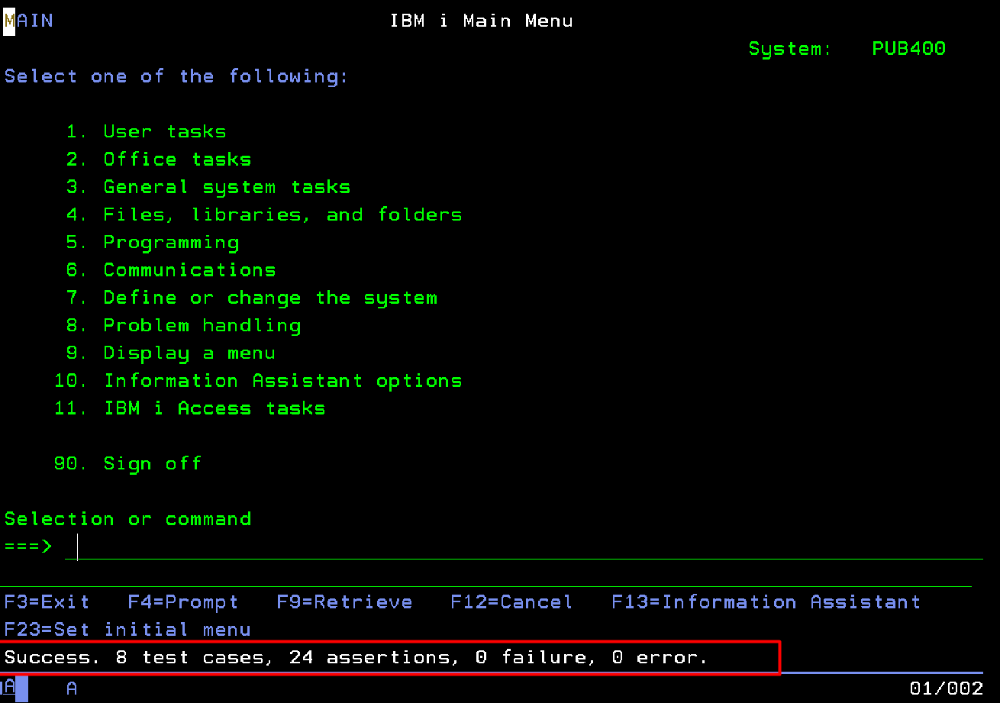 | 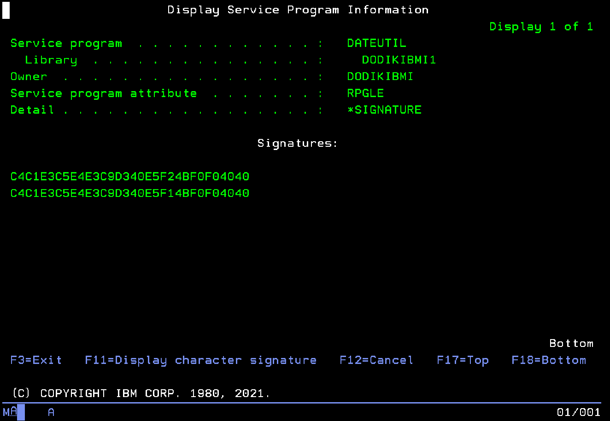 |

### REST API

| `GET /api/items/OF-0001` | `GET /api/stock?warehouse=EST&reorder=Y` |
|---|---|
| 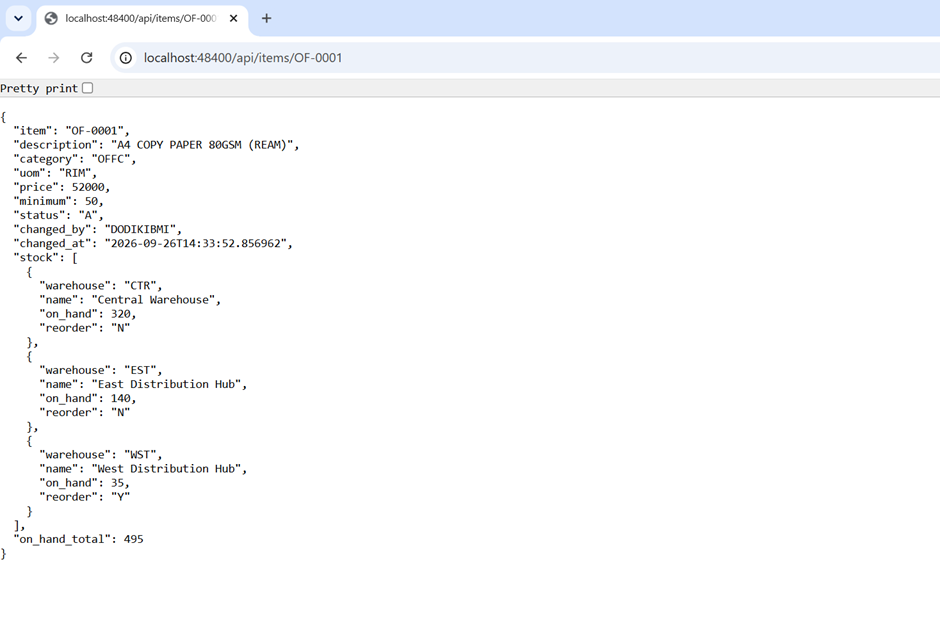 | 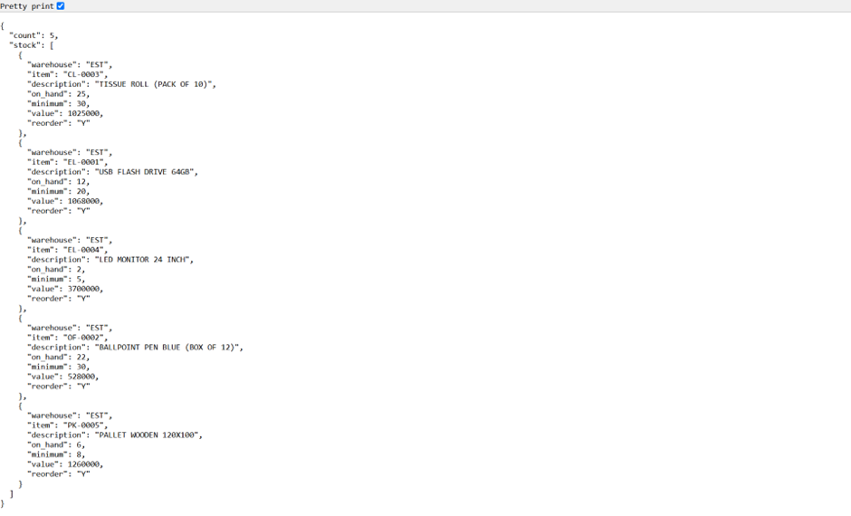 |

`POST /api/movements` with more than the stock on hand returns `409`:

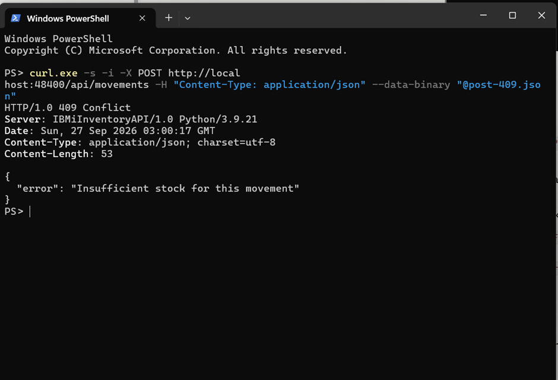

## Database

Tables are created with SQL DDL (primary keys, foreign keys, check constraints, identity
column, labels). Each table has a 10-character system name and a record format, so RPG
uses native I/O (`CHAIN`, `SETLL`/`READE`, `WRITE`, `UPDATE`) on the SQL indexes.

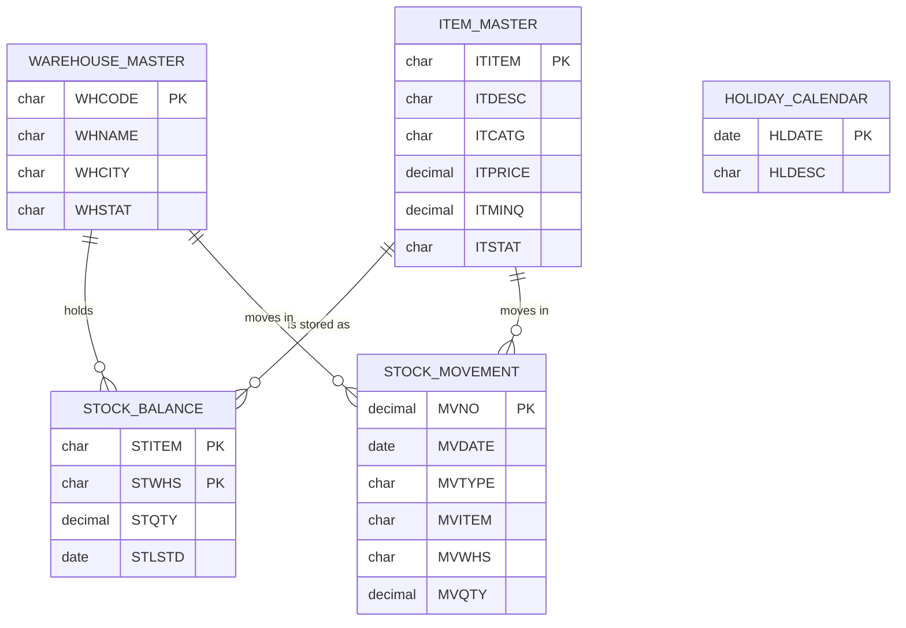

| SQL name | System name | Keyed access (index) |
|---|---|---|
| `WAREHOUSE_MASTER` | `INVWHS` | `INVWHS1` by code |
| `ITEM_MASTER` | `INVITM` | `INVITM1` by code, `INVITM2` by description |
| `STOCK_BALANCE` | `INVSTK` | `INVSTK1` by item + warehouse |
| `STOCK_MOVEMENT` | `INVMOV` | `INVMOV1` by item + warehouse + date + number |
| `HOLIDAY_CALENDAR` | `INVHOL` | `INVHOL1` by date |
| `STOCK_STATUS` (view) | `INVSTKV` | used by the report and the JSON export |

Three layers protect the stock from going negative: validation in `INV200R`, a second
check while the stock row is locked, and `CHECK (STQTY >= 0)` in the database.

## Design notes

- **Hybrid free-format RPG.** H, F, D and P specs are fixed-format; logic is in `/free`
  blocks. This is the style most existing IBM i shops maintain, and it compiles on any
  release that has free-format calculations.
- **Optimistic locking** (`INV110R`). The record is shown without a lock and re-read with
  a lock before the update; if the change timestamp differs, another user changed it and
  the screen is reloaded instead of overwriting their work. No lock is held while the
  user is typing.
- **Commitment control started by the program** (`INV200R`). `STRCMTCTL
  LCKLVL(*CHG) CMTSCOPE(*ACTGRP)` through `QCMDEXC`, then the journaled files are opened
  (`COMMIT USROPN`). The tables are journaled automatically because the data library
  contains journal `QSQJRN`.
- **Identity column and native I/O.** `MVNO` is generated by Db2 on the RPG `WRITE`; the
  program reads it back before `COMMIT`, while it still holds the stock row lock.
- **Service program versioning** (`DATEUTILB`). Version 1.00 had seven exports; 2.00 added
  `DateAddWdays` at the end. The `*PRV` block keeps the 1.00 signature valid, so programs
  bound to 1.00 run without being re-bound. Both signatures and the one each caller is
  bound to can be checked with SQL (`QSYS2.PROGRAM_INFO.EXPORT_SIGNATURES`,
  `QSYS2.BOUND_SRVPGM_INFO.BOUND_SERVICE_PROGRAM_SIGNATURE`; the signature is the
  EBCDIC text, e.g. `C4C1E3C5E4E3C9D340E5F24BF0F04040` = `DATEUTIL V2.00`).
- **One reusable prompt window** (`INV900R`) serves items, warehouses and movement types.
  A `DUMMY` record with `ASSUME` keeps the calling screen visible under the window.

## REST API

The same data is available as JSON over HTTP, served by a small Python program that
runs in PASE on the IBM i itself (`api/server.py`, standard library + `ibm_db`, which
both ship with the IBM i open-source packages). Writes go through the SQL procedure
`POST_MOVEMENT`, so the API and the green screens apply exactly the same rules.

| Method | Path | Result |
|---|---|---|
| GET | `/api/health` | database and schema in use |
| GET | `/api/items?category=OFFC&status=A` | item list |
| GET | `/api/items/{code}` | one item with stock per warehouse |
| GET | `/api/stock?warehouse=CTR&reorder=Y` | stock status, optionally only items to reorder |
| GET | `/api/movements?item=OF-0001&warehouse=CTR&from=2026-09-01` | movement history |
| POST | `/api/movements` | post a movement; `201` with the movement number and new stock |

Errors are JSON with a matching status: `400` invalid input, `404` unknown item or
inactive warehouse, `409` insufficient stock, `500` anything unexpected.

```text
POST /api/movements  {"type":"O","item":"OF-0001","warehouse":"CTR","quantity":5,"reference":"DO-1"}
201  {"number": 18, "item": "OF-0001", "warehouse": "CTR", "type": "O", "quantity": 5,
      "date": "2026-09-26", "on_hand": 320}

POST /api/movements  {"type":"O","item":"EL-0005","warehouse":"CTR","quantity":999}
409  {"error": "Insufficient stock for this movement"}
```

Run it on PUB400 (one command from a PC; it opens an SSH tunnel to port 48400, asks
the database password without echo and starts the server):

```text
ssh -t -p 2222 -L 48400:127.0.0.1:48400 USER@pub400.com /QOpenSys/pkgs/bin/bash /home/USER/inventory/api/start_api.sh
```

Then open `http://localhost:48400/api/health` in the browser. `api/test_api.sh` runs a
smoke test with `curl` (success and error cases).

The other direction — RPG calling a web service — is `INV600R`: Db2 fetches
`https://date.nager.at/api/v3/PublicHolidays/{year}/ID` with `QSYS2.HTTP_GET_VERBOSE`
(plain `HTTP_GET` hands back the body of a 404 without any SQL error, so the program reads
the status code first and stops with `CPF9898` on anything outside 200-299),
`JSON_TABLE` turns the array into rows and `MERGE` inserts or updates
`HOLIDAY_CALENDAR` for this year and next year. `DATEUTIL` picks the new dates up
immediately, without a recompile. (That free API lists the fixed national holidays;
holidays that follow the lunar calendar are not included.)

`INV700R` pushes data out: `LISTAGG` collapses the items below their minimum into one
line per warehouse (`WST (CL-0001, OF-0001, PK-0001, PK-0003)`), Db2 wraps it in a JSON
message and `QSYS2.HTTP_POST_VERBOSE` posts it to a webhook (default `https://httpbin.org/post`,
pass a Slack/Teams/ERP URL as the first parameter). The HTTP status is read from the response
header JSON; anything outside 200-299 ends the program with `CPF9898`, so a CL job can
`MONMSG` it.

```text
CALL INV700R                     /* posts to the default https://httpbin.org/post */
```

From CL, pass your own URL in a `*CHAR 200` variable (a literal on a command-line `CALL`
is only as long as its text, and the program reads 200 bytes).

## Build

Libraries: source and programs in `DODIKIBMI1`, data in `DODIKIBMI2`. Change the names
to your own. [iRPGUnit](https://github.com/tools-400/irpgunit) is needed only for the
test suite.

```text
/* 1. Journal first: tables created in a library with QSQJRN are journaled */
CRTJRNRCV JRNRCV(DODIKIBMI2/INVRCV0001)
CRTJRN    JRN(DODIKIBMI2/QSQJRN) JRNRCV(DODIKIBMI2/INVRCV0001) MNGRCV(*SYSTEM) DLTRCV(*YES)

/* 2. Database and sample data (stream files in the IFS)                   */
RUNSQLSTM SRCSTMF('sql/01_tables.sql') COMMIT(*NONE) NAMING(*SQL) DECMPT(*PERIOD)
RUNSQLSTM SRCSTMF('sql/02_data.sql')   COMMIT(*NONE) NAMING(*SQL) DECMPT(*PERIOD)
RUNSQLSTM SRCSTMF('sql/03_api.sql')    COMMIT(*NONE) NAMING(*SQL) DECMPT(*PERIOD)

/* 3. Service program, binding directory and its unit tests                */
CRTRPGMOD  MODULE(DATEUTIL) SRCFILE(QRPGLESRC)
CRTSRVPGM  SRVPGM(DATEUTIL) EXPORT(*SRCFILE) SRCFILE(QRPGLESRC) SRCMBR(DATEUTILB)
CRTBNDDIR  BNDDIR(INVENTORY)
ADDBNDDIRE BNDDIR(INVENTORY) OBJ((DATEUTIL *SRVPGM))
RUCRTRPG   TSTPGM(DATEUTILT) SRCFILE(QRPGLESRC) BNDSRVPGM(DATEUTIL)
RUCALLTST  TSTPGM(DATEUTILT)

/* 4. Display and printer files before the programs that use them          */
CRTDSPF FILE(INV100D) SRCFILE(QDDSSRC)
CRTDSPF FILE(INV110D) SRCFILE(QDDSSRC)
CRTDSPF FILE(INV200D) SRCFILE(QDDSSRC)
CRTDSPF FILE(INV300D) SRCFILE(QDDSSRC)
CRTDSPF FILE(INV900D) SRCFILE(QDDSSRC)
CRTDSPF FILE(INVMNUD) SRCFILE(QDDSSRC)
CRTPRTF FILE(INV400P) SRCFILE(QDDSSRC) PAGESIZE(66 132) OVRFLW(60)

/* 5. Programs                                                             */
CRTBNDRPG  PGM(INV900R) SRCFILE(QRPGLESRC)
CRTBNDRPG  PGM(INV110R) SRCFILE(QRPGLESRC)
CRTBNDRPG  PGM(INV100R) SRCFILE(QRPGLESRC)
CRTBNDRPG  PGM(INV200R) SRCFILE(QRPGLESRC)
CRTBNDRPG  PGM(INV300R) SRCFILE(QRPGLESRC)
CRTSQLRPGI OBJ(INV400R) SRCFILE(QRPGLESRC) COMMIT(*NONE)
CRTSQLRPGI OBJ(INV500R) SRCFILE(QRPGLESRC) COMMIT(*NONE)
CRTSQLRPGI OBJ(INV600R) SRCFILE(QRPGLESRC) COMMIT(*NONE)
CRTSQLRPGI OBJ(INV700R) SRCFILE(QRPGLESRC) COMMIT(*NONE)
CRTBNDCL   PGM(INVMENU) SRCFILE(QCLSRC)

/* 6. Run                                                                  */
CALL INVMENU
```

## Sample output

Stock status report (`INV400P`, excerpt):

```text
Item        Description                               Cat   UOM       On hand     Minimum       Unit price           Stock value  R
------------------------------------------------------------------------------------------------------------------------------------
Warehouse EST  East Distribution Hub
CL-0003     TISSUE ROLL (PACK OF 10)                  CLNG  PAK           25          30        41.000,00          1.025.000,00   *
EL-0001     USB FLASH DRIVE 64GB                      ELEC  PCS           12          20        89.000,00          1.068.000,00   *
OF-0001     A4 COPY PAPER 80GSM (REAM)                OFFC  RIM          140          50        52.000,00          7.280.000,00
            Total     7 items,     5 to reorder                          487                                      17.521.000,00
GRAND TOTAL          32 items,    11 to reorder                        2.765                                     113.478.500,00
```

(Decimal comma because the PUB400 job runs with a German locale.)

JSON export: see [`docs/sample-stock_status.json`](docs/sample-stock_status.json).

Unit tests:

```text
RUCALLTST TSTPGM(DATEUTILT)
Success. 8 test cases, 24 assertions, 0 failure, 0 error.
```

## Notes from running on PUB400

- `FOR SYSTEM NAME` is rejected (SQL7029) when the SQL name is itself a valid system
  name, which is why the tables have names longer than 10 characters.
- `DEFAULT USER` needs a column of at least 18 characters (SQL0574).
- The job locale uses a decimal comma, so `RUNSQLSTM` runs with `DECMPT(*PERIOD)`.
- Batch jobs submitted from a user job queue do not match the batch subsystem's routing
  entries (CPC1117), so the menu prints the report in the interactive job. On a regular
  system that option would be `SBMJOB ... CALL PGM(INV400R)`.
- A local `ibm_db` connection without a user is refused (SQL30082), so the API
  connects with the user's credentials from environment variables. That makes it a
  server-mode connection: the API opens it once and serves requests one at a time.
- `ibm_db.callproc` sizes an OUT parameter buffer from its initial value and does not
  clear the rest after the returned digits, so the OUT parameters start as blanks.

## Repository layout

```text
sql/         01_tables.sql, 02_data.sql, 03_api.sql (procedure POST_MOVEMENT)
api/         server.py (REST API), start_api.sh, test_api.sh
qddssrc/     display files (*.dspf) and printer file (*.prtf)
qrpglesrc/   RPGLE / SQLRPGLE programs, DATEUTIL module, copybook, binder source, tests
qclsrc/      main menu (CLLE)
docs/        sample output, screenshots/
```

## License

© 2026 Dodik Setyawan. All rights reserved. The code is published for viewing as a
portfolio; reuse requires written permission. See [LICENSE](LICENSE).
